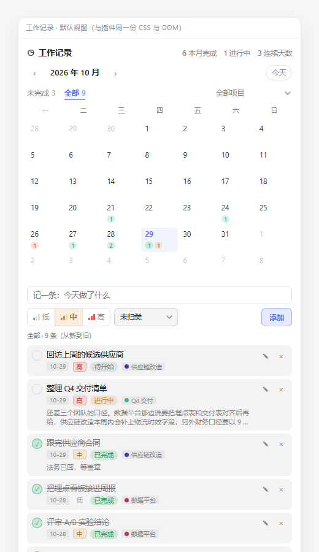

# dsh-worklog —— DSH 工作记录

按天记录手头的活儿，用月历回看每天「完成了什么、还有什么在进行」。所有数据只存在本机的一个 JSON 文件里，不联网、不需要账号。



## 它能做什么

- **按天记录**：每条任务挂在某一天上，标题 + 备注，状态四档：
  - `待开始` / `进行中` / `已完成` / `已阻塞`
  - 点圆圈直接完成/取消完成；点状态胶囊按「待开始 → 进行中 → 已完成 → 已阻塞」循环
  - 备注单独一行显示、最长两行，**点一下展开全文**（编辑时是多行输入框，支持换行）
- **项目归类**：每条任务可以挂一个项目（下拉选择，也可以在下拉里「＋ 新建项目…」），没填就是「未归类」
  - 项目颜色由名字哈希得出，不用配置；切换筛选时日历、明细、顶部统计一起变
  - 「管理项目」可**改名**（一并改掉该项目的所有任务；改成已有名字就是合并）和**删除**（任务退回未归类，不删任务）
- **优先级**：`低 / 中 / 高`（默认中），新建与编辑时用「信号格 + 颜色」的三档控件选取（低 1 格灰蓝、中 2 格琥珀、高 3 格红）；列表里点那个字直接切换；`未完成` 视图按「高 → 中 → 低、同优先级按日期」排序
- **一条工具栏**（日历上方）：左边 `未完成 N`（默认）/ `全部 M`，右边按项目筛选（下拉里最后一项是「管理项目…」）；两者是**与**的关系
  - `未完成`：所有没做完的，按记录日期从早到晚，过期未完成的日期标红
  - `全部`：所有记录，从新到旧
  - 两个视图都不受当前月份限制，新建的任务默认记在今天
- **月历回溯**：每格显示当天的完成数、进行中数、阻塞数；**点某一天只看那天**（日期会作为 `10-14 ×` 条件出现在工具栏里，再点一次或点 `×` 取消，换月自动取消）。日历上的色标始终按项目筛选算，不会被「选中某天」清空
- **统计**：本月完成、当前进行中、连续记录天数（每天至少完成 1 条算一天），跟随当前项目筛选
- **在对话里直接记**：装了 4 个 Agent 工具，可以让模型代劳（见下）
- **两个入口**（三个位置，哪个能用用哪个）：
  1. 会话头部「◷ 记录」按钮 → 右侧抽屉
  2. 右侧栏的「◷ 工作记录」标签页
  3. 设置 → 工作记录（整页）

## 在对话里用

装了这四个工具之后，不用打开面板也能记：

| 工具 | 什么时候用 | 例子 |
|---|---|---|
| `worklog_add` | 记一条新任务 | 「记一下，今天跟完供应商合同，放供应链改造」 |
| `worklog_update` | 改状态 / 挪日期 / 改标题项目 | 「把跟完供应商合同那条标记成已完成」 |
| `worklog_list` | 按日期区间 / 项目 / 状态 / 关键词查 | 「这周供应链改造还有什么没做完？」 |
| `worklog_projects` | 看各项目的任务数与完成情况 | 「我现在有几个项目？」 |

工具和面板共用同一份 `core.js` 逻辑，落的是同一个文件，两边不会各写各的。

## 安装

### 从 GitHub 装（换电脑、多台机器推荐）

```powershell
dsh plugin --profile desktop add "github:EastChilde/dsh-worklog"
```

装完**重启 DSH**。以后改代码推到仓库、再跑一次同样的 `add` 命令就是更新。

### 从 Gitee 装（国内网络更稳）

仓库镜像：<https://gitee.com/EastChilde/dsh-worklog>

```powershell
git clone https://gitee.com/EastChilde/dsh-worklog.git "$env:USERPROFILE\dsh-worklog"
dsh plugin --profile desktop add "link:$env:USERPROFILE/dsh-worklog"
```

`dsh plugin add` 目前只认 `npm 包名 / github:owner/repo / link:本地目录` 三种目标，所以 Gitee 走「clone 下来再 link 本地目录」。之后更新：`git -C $env:USERPROFILE\dsh-worklog pull`，再重启 DSH。

### 从本地目录装（改代码时用）

先在终端做一次语法自检（可选，但省事）：

```powershell
node --check "C:\Users\Administrator\Documents\deepseek-harness\default-workspace\dsh-worklog\lib\index.js"
node --check "C:\Users\Administrator\Documents\deepseek-harness\default-workspace\dsh-worklog\client\client.js"
```

然后装进当前 profile（这台机器上是 `desktop`）：

```powershell
dsh plugin --profile desktop add "link:C:/Users/Administrator/Documents/deepseek-harness/default-workspace/dsh-worklog"
```

装完**重启 DSH**（客户端插件要重新加载 bundle 才生效，刷新页面不够）。

如果终端里没有 `dsh` 命令：打开「设置 → 插件市场 → 自定义安装」，把上面这个目录路径粘进去，效果一样。

## 数据在哪

> **插件 ≠ 数据。** 装到新电脑只得到「程序」，任务还在各自机器的这个文件里。要把记录带过去，复制下面这个文件。

```
%USERPROFILE%\.dsh\dsh-worklog\tasks.json
```

（若设置了 `DSH_HOME` 环境变量，则在 `$DSH_HOME\dsh-worklog\tasks.json`。面板底部会直接显示真实路径。）

- 备份：复制这个文件即可。
- 迁移：把文件放到新机器的同一位置。
- 写入是「临时文件 + 原子改名」，写到一半断电也不会留下半个 JSON。

数据结构：

```json
{
  "version": 1,
  "tasks": [
    {
      "id": "t_lq3k9x1a",
      "date": "2026-10-20",
      "title": "跟完供应商合同",
      "status": "done",
      "note": "法务已回，等盖章",
      "project": "供应链改造",
      "createdAt": "2026-10-20T02:15:00.000Z",
      "updatedAt": "2026-10-20T08:40:00.000Z",
      "doneAt": "2026-10-20T08:40:00.000Z"
    }
  ]
}
```

## 卸载

```powershell
dsh plugin --profile desktop remove dsh-worklog
```

卸载不会删数据文件；想彻底清掉就手动删 `%USERPROFILE%\.dsh\dsh-worklog\` 目录。

## 排错

- 插件加载时会在宿主日志里打一行 `[dsh-worklog] 已就绪，数据文件：…`，说明服务端路由挂上了；随后会有一行 `已注册 4 个 Agent 工具`。
- 没有那行工具日志 = 宿主的 `tools` 服务没拿到，或 `@deepseek-ai/dsh-tools` 解析不到；面板功能不受影响，日志里会有具体原因。
- 面板里读不到数据会显示「读取失败：…」，一般是没有重启、或路由没注册。
- 入口只出现一部分是正常的：右侧栏标签依赖宿主的 `sidebar.right.pane.tab` 槽位；头部按钮和设置页是保底入口。

## 改代码后怎么生效

| 改了什么 | 怎么做 |
|---|---|
| `lib/core.js`（存储、校验、统计口径） | `Invoke-WebRequest -Method POST http://127.0.0.1:<端口>/dsh-worklog/reload`，不用重启 |
| `lib/index.js`（路由表、插件挂载） | 重启 DSH |
| `client/client.js`（界面） | 刷新页面（不行就重启） |

